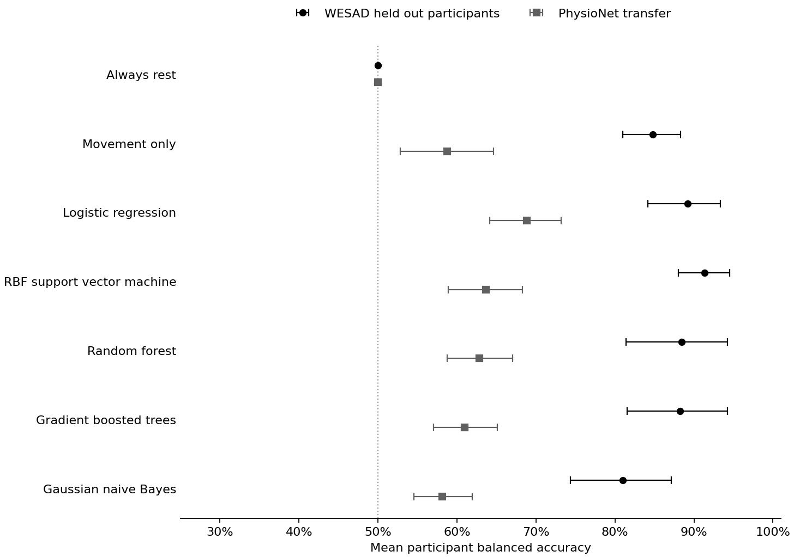

# StressSense final report

DH803 Wearable Health Technologies

## Research question

Can a model use 30 seconds of wrist recordings to tell a stress task from rest? We tested it first on other people from the same study, then on recordings from a separate study. Both teams used the same wristband. Earlier work found that results change when the source and test studies differ. [Mishra et al.](https://doi.org/10.1145/3432220)

The RBF support vector machine had the highest score within WESAD at 91.3% balanced accuracy. In PhysioNet, logistic regression led the five models at 68.9%. Every model scored lower in the second study.

## Data and labels

| Data used | Participants | Baseline or rest windows | Stress windows |
| --- | ---: | ---: | ---: |
| WESAD | 15 | 578 | 322 |
| PhysioNet v1.0.1 | 34 | 1,357 | 276 |

Both studies recorded blood volume pulse, skin conductance, wrist temperature and acceleration with the Empatica E4. In WESAD we kept the baseline and Trier Social Stress Test periods from the aligned wrist recordings. In PhysioNet we matched the four signals to the event marks for each version of the protocol. Initial baseline and breaks between tasks make up the rest class. We used the task schedule to label stress. Short speech and subtraction blocks often yielded no full 30 second window. Mental arithmetic made up 208 of 276 PhysioNet stress windows. [WESAD](https://ubi29.informatik.uni-siegen.de/usi/data_wesad.html), [PhysioNet](https://physionet.org/content/wearable-device-dataset/1.0.1/)

We excluded S02 because the source documents duplicated signals and f07 because the protective dock covered two sensors. For f14 we used the tagged part of the split recording. Its untagged baseline was omitted. Exercise, amusement and unassigned time were outside the analysis. Participant and window totals and archive checksums are recorded in the [data audit](results/data_audit.json).

## Signal processing and evaluation

The pipeline uses consecutive 30 second windows, leaving a five second guard at each end of a labeled block. It uses the original sampling rate for each sensor. Acceleration is converted to units of g. The features are:

| Signal | Features |
| --- | --- |
| Blood volume pulse | Median interval converted to pulse rate and interquartile range of valid pulse intervals |
| Skin conductance and wrist temperature | Mean, standard deviation, slope and 90th minus 10th percentile |
| Acceleration | Spread of vector magnitude, mean variation across axes and average change per second |

We filtered the pulse trace between 0.6 and 4 Hz and looked for peaks. We kept intervals from 0.33 to 1.50 seconds and required accepted intervals to cover at least 18 seconds. Motion can distort the optical trace. The two pulse features were missing in 53 WESAD windows and 18 PhysioNet windows. The remaining features were available in all windows. During each fit we filled missing values with medians from the training participants. [Bent et al.](https://doi.org/10.1038/s41746-020-0226-6)

Logistic regression was the original model. We compared four other algorithms using the same 13 features. To test within WESAD, we kept one person's recordings entirely outside training and fitted on the other 14. We repeated the process for all 15. For the separate study, we fitted on all of WESAD and kept those fits fixed when scoring PhysioNet. We left the test data out of the preprocessing and model fits. The settings below are fixed choices for this comparison. [Saeb et al.](https://doi.org/10.1093/gigascience/gix019)

| Model | Main settings |
| --- | --- |
| Logistic regression | C = 1, balanced class weights |
| RBF support vector machine | C = 1, gamma from scaled training features, balanced class weights |
| Random forest | 200 trees, at least 5 rows per leaf, balanced class weights |
| Histogram gradient boosting | 150 iterations, up to 15 leaves per tree, at least 10 samples per leaf, learning rate 0.1, L2 penalty 1, balanced class weights |
| Gaussian naive Bayes | Equal class priors |

We standardized the inputs to logistic regression, SVM and naive Bayes using the training data. We used a cutoff above 0.5 for model scores and a positive decision margin for the SVM. The SVM score in the CSV is a sigmoid of its margin for display. It remains uncalibrated. We also tested an always rest rule and refitted logistic regression with only acceleration or with one sensor at a time omitted. [Code](stresssense/evaluate.py)

Balanced accuracy gives equal weight to stress recall and rest recall. We calculated each metric within a participant and then averaged across participants. The 95% percentile intervals resample participant scores 5,000 times. They describe sample variation conditional on these evaluations and do not include the uncertainty of retraining on a new source study.

## Results

| Model | WESAD held out people | PhysioNet transfer |
| --- | ---: | ---: |
| Logistic regression | 89.2% | 68.9% |
| RBF support vector machine | 91.3% | 63.7% |
| Random forest | 88.5% | 62.8% |
| Gradient boosted trees | 88.3% | 60.9% |
| Gaussian naive Bayes | 81.0% | 58.1% |
| Always predicts rest | 50.0% | 50.0% |
| Movement only | 84.8% | 58.8% |

These are mean participant balanced accuracies. Within WESAD, the SVM averaged 2.1 percentage points above logistic regression. The paired 95% bootstrap interval ran from 1.6 points below to 6.1 above. On PhysioNet, the SVM averaged 5.2 points below logistic regression, with an interval from 8.7 below to 1.7 below. We calculated the difference on each person before resampling. We added the new algorithms after the original logistic run, so this is a follow up comparison on the same test study.

On PhysioNet, logistic regression recovered 73.3% of stress windows per person on average, compared with 58.6% for the SVM. The SVM correctly labeled more rest windows on average, at 68.8% compared with 64.4%. Logistic regression missed 77 of the 276 stress windows and called 440 of the 1,357 rest windows stress when we pooled all PhysioNet windows. Its stress F1 was 86.2% in WESAD and 44.6% in PhysioNet.

| Logistic regression inputs | WESAD | PhysioNet |
| --- | ---: | ---: |
| All four signals | 89.2% | 68.9% |
| Without pulse | 86.1% | 61.5% |
| Without skin conductance | 87.4% | 66.6% |
| Without wrist temperature | 88.1% | 65.7% |
| Without acceleration | 84.6% | 67.0% |

Leaving out pulse lowered the PhysioNet score the most. Acceleration alone reached 84.8% within WESAD. The watch may pick up movements that go with speaking or doing a task. This is one reason to be careful about treating a good WESAD score as evidence of stress detection in everyday life.

### How the comparison condition affected the result

The primary model scored 65.1% balanced accuracy on PhysioNet's first protocol and 72.6% on its second. These were separate cohorts with changes in their tasks and rest schedules. The comparison cannot isolate a single cause. Among the 33 people with a labeled initial baseline, balanced accuracy was 58.4% when we kept the stress windows and used only that initial baseline as the negative class. This is a sensitivity analysis with the same fitted model and cutoff. It shows how strongly the result depends on which intervals count as rest.

## What the result supports

The algorithm that led within WESAD was different from the one that led on PhysioNet. Logistic regression lost about 20 percentage points when the protocol and participants changed. To judge a model for a new setting, we need recordings from that setting. We also need to count missed stress tasks and false alarms separately, since the two errors can tell a different story from one average.

These are task labels from two controlled studies. People can experience different levels of stress while doing the same task, and movement, speech and recovery can differ across task blocks. Age, device placement, protocol and study effects were not separated. The evaluation did not test ordinary activities or use perceived stress as the prediction target. An independent evaluation with movement matched activities or data collected in everyday life would address a different and harder question.

The [reproduction instructions](README.md) cover data preparation, model fitting and the offline recording replay. The [exact output](results/summary.json) contains all models, confusion matrices and uncertainty intervals. The [bibliography](REFERENCES.md) links the dataset documentation and research sources.
